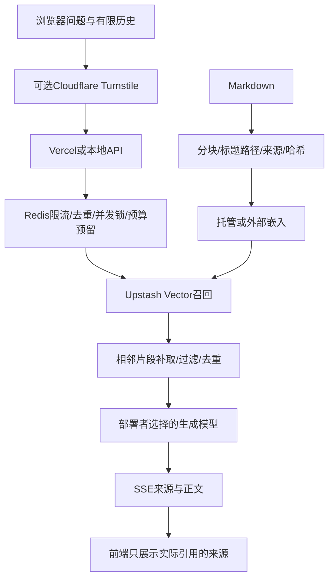
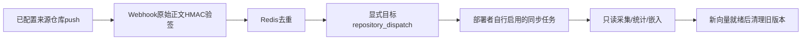

# Markdown RAG Starter

把自己的Markdown资料接成带来源的知识库问答。项目包含文档分块、向量检索、流式模型回答、React聊天界面、只读检索接口，以及签名Webhook驱动的内容更新入口。默认资料是虚构的开发文档，不依赖作者原站点或已有知识库。

## 先运行本地示例

需要Node.js22.19以上与npm。以下操作不需要原作者的账号或服务。

```sh
git clone https://github.com/schrolemons/schnie-rag.git
cd schnie-rag
npm ci
npm run privacy:check
npm run check
npm test
npm run sync:vector:check
npm run demo:offline
npm run build
npm start
```

打开http://127.0.0.1:8787可以查看界面。`demo:offline`用真实业务函数配合明确的Redis、向量库和模型替身演示链路；未配置云服务时，正常问答和检索接口会报依赖未配置。能打开页面或通过`/health`不等于真实模型、数据库已经可用。

开发时先启动`npm start`，再在另一终端执行`npm run dev`，访问http://127.0.0.1:5173。Vite代理API到8787，单独启动前端不会启动后端。

## 接上自己的资料和服务

1. 复制`.env.example`为`.env`，填写自己的Redis、Vector和模型凭据。示例默认使用DeepSeek生成接口；浏览器模型设置可为单次会话提供允许的其他兼容接口。
2. 把已授权公开的Markdown放进`src/content/<来源ID>/`，删除三篇演示文章。每篇文章建议用frontmatter的`title`、HTTPS `url`指定真实标题和原文链接；不要用示例网址充当真实出处。
3. `lib/source-sites.js`统一定义来源ID、名称、仓库、分支和站点网址。可增删来源；来源ID同时构成默认分类清单，frontmatter的`category`可在该清单中选择。不会按文章名称强制改写分类、作者或出处。
4. Vector使用独立的`kb-`前缀分区；读写两端配置同一namespace。索引需启用兼容的托管嵌入，或明确配置外部Embeddings API及相同维度。同步保护阈值由`.env.example`中的`VECTOR_MAX_*`配置，不代表服务商套餐额度，应按自己的Dashboard调整。
5. 先运行`npm run sync:vector:check`离线核对，再运行`npm run sync:vector`正式入库。正式同步会产生数据库和嵌入调用，并清理当前分区的旧版本；不要指向其他应用的生产分区。
6. 执行`npm run build`并重启本地入口，先查询一段已知原文，再测试真实流式问答和来源链接。

| 配置 | 职责 |
| --- | --- |
| `UPSTASH_REDIS_REST_URL/TOKEN` | 服务端限流、请求去重、并发锁、预算与短时缓存 |
| `UPSTASH_VECTOR_REST_URL/TOKEN` | 服务端向量查询与入库；同步需要写权限 |
| `UPSTASH_VECTOR_NAMESPACE` | 当前项目专用分区，示例为kb-demo |
| `VECTOR_EMBEDDING_MODE` | upstash-data或external；与索引的嵌入方式配套 |
| `VECTOR_EMBEDDING_MODEL/URL/API_KEY/DIMENSION` | 外部嵌入服务及维度；更换模型需要重新嵌入 |
| `DEEPSEEK_API_KEY` | 默认生成模型凭据，仅服务端使用 |
| `CHAT_ALLOWED_ORIGINS` | 浏览器允许来源，按实际前端域名配置 |
| `CHAT_ALLOWED_MODEL_HOSTS` | 访客自定义模型接口的额外精确主机白名单 |
| `CHAT_DAILY_REQUESTS / CHAT_DAILY_TOKEN_BUDGET` | 保守的全站请求和输入输出预算预留 |
| `PUBLIC_TURNSTILE_SITE_KEY`、`TURNSTILE_SECRET_KEY` | 可选Cloudflare Turnstile，公开站点Key与服务端Secret需配套 |
| `CHAT_SYSTEM_PROMPT` | 可选的部署者自定义说明，仅在服务端配置；不提交真实私有提示词 |

除明确公开的构建变量外，凭据和私有说明不能使用`PUBLIC_`前缀。`.env`已忽略。模型Key只在当前页面内存保留，并随请求发给你部署的后端用于访问所选模型；检索插件不读取这个Key。

## 完整链路



Cloudflare在本项目中负责可选的Turnstile验证；API运行在Vercel或本地Node，不要求Cloudflare Worker。Redis保存访问控制与短期状态，Vector保存嵌入和来源元数据，生成模型根据候选证据回答。分数是检索配置，不能作为事实准确率。

## 给DSH插件复用

`POST /api/knowledge`只做检索或读取总览，不调用生成模型。把自己的部署地址显式配置给[知识库检索插件](https://github.com/schrolemons/schnie-harness-plugin)即可：

```json
{"operation":"search","query":"安装步骤","site":"all","mode":"chat"}
```

返回`schema:1`、请求ID、来源清单；每条来源有稳定的16位十六进制ID、title、HTTPS url和原文text。总览使用`operation:overview`。来源ID需与本项目配置一致，错误返回通用code和请求ID，不回显凭据或上游原始响应。

两仓库可放在同级目录，然后在本项目执行真实HTTP对接检查：

```sh
node scripts/verify-plugin.mjs ../schnie-harness-plugin/lib/knowledge-client.js
```

该检查启动临时回环HTTP入口，真实解析插件请求和API响应，并验证问答SSE；外部Redis、Vector和模型使用显式替身，不代表云服务已验收。

## 内容更新和部署



仓库没有启用Actions。`docs/upstream/sync-vector.yml`只是参考模板，不会执行；有自动更新需求时，部署者需先配置来源、分支、目标、Secrets和权限，再自行采用。Webhook目标未配置时返回503，不会派发到原作者仓库。

Vercel使用`npm run build`、输出`dist`，根目录`api/`承载后端；环境变量在自己的部署中设置。更详细的来源采集、签名更新和验证边界见[内容流水线](docs/content-pipeline.md)、[本地与部署](docs/world-terminal.md)、[验证记录](VALIDATION.md)。

## 隐私与边界

当前公开版只带通用说明和合成资料，不预装个人提示词、聊天历史、角色设定、Cookie或作者服务凭据。`privacy:check`检查当前文件，`privacy:history`另外检查当前HEAD可达的Git历史；仅修改最新文件不能清除已公开的旧提交或旧发布包。扫描只报告路径和类别，不输出敏感值。

只读检索接口默认是匿名公开接口，不能直接承载公司内部或私人资料；需要私有资料时，应在部署层增加认证、网络隔离与访问控制。Origin和Turnstile不是用户身份认证。模型可能误读资料，来源链接用于核对，项目不承诺零幻觉。

项目从作者的公开launcher模块提取，仓库名与链接保留兼容；通用版默认行为独立于原知识库。保留上游MIT署名，详见[NOTICE](NOTICE.md)与[LICENSE](LICENSE)。
